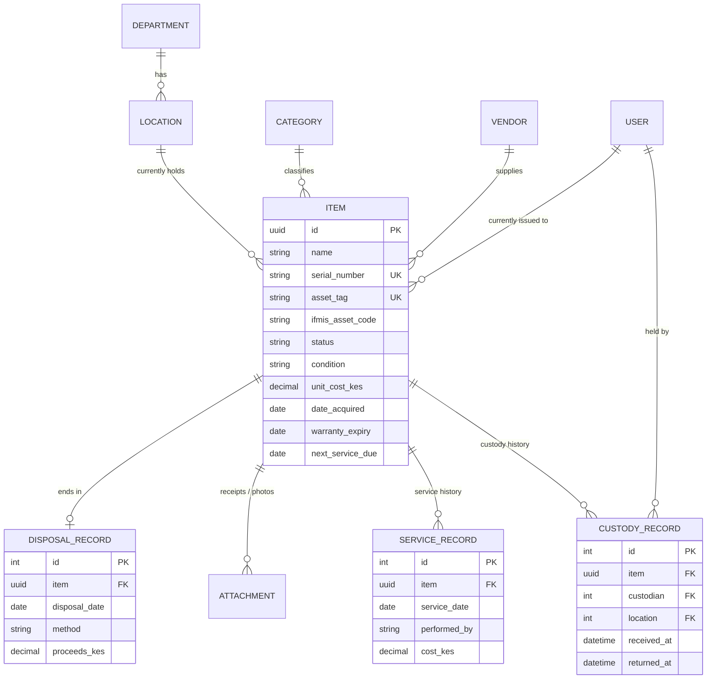

# Data model

## Design notes

- **`Item` is never deleted.** Disposal is modeled as a `DisposalRecord`, not a row removal -- the register must reconcile with historical audit reports years later, and the Office of the Auditor-General needs the full trail.
- **History tables are append-only in practice.** `CustodyRecord` and `ServiceRecord` allow `create`/`read` in the API but block `destroy`; nothing rewrites the past.
- **`django-auditlog`** additionally captures field-level before/after diffs (who changed what, when) on `Item`, `CustodyRecord`, `ServiceRecord`, and `DisposalRecord`, independent of the domain tables above -- so even a legitimate status correction is traceable.
- **Denormalized `current_custodian` / `current_location` on `Item`** exist purely for fast list-page queries; a Django signal keeps them in sync whenever a new `CustodyRecord` is written. `CustodyRecord` remains the source of truth.
- **`ifmis_asset_code`** cross-references the Treasury's own IFMIS record for the same asset, where one exists.
- **Indexes** on `status`, `category`, the `(status, current_location)` pair, `created_at`, and `next_service_due` back the dashboard aggregates and the cursor-paginated list views without full table scans as the register grows.
